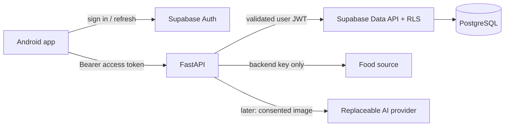

# Architecture proposal

## Stage 11 hardening

Diary validation groups entries once by date before checking daily totals, preserving entry order and existing snapshot/schema semantics. Exiting uncertain diary mutations reloads authoritative persisted state and hides stale displayed entries while loading. Checkpoint persistence (still unmounted) preserves acknowledged revisions/tombstones monotonically, even when supplied the current original snapshot. No schema, dependency or live-cloud changes. Evidence and unresolved release gates: [Release readiness](RELEASE_READINESS.md).

## Stage 10 read-only insights

`domain/insights.ts` consumes loaded `DiaryProvider`/`HealthProvider` snapshots through `insightView`, with explicit loading/error/ready states. It reuses `indexDiaryDates`, `diaryTotals`, local `shiftDay`/date validation, `targetsForDate`, `validateHealth` and `weightProgress`. Calculations do not look up current foods or recipes and do not mutate input objects. Duplicate IDs fail closed rather than double-counting. Existing providers remain the only storage paths; no new repository or SQL migration is needed.

`InsightsScreen` is an Expo Router stack destination linked from Progress. Shared cards, date fields, AddFood, nutrient progress and WeightChart retain themes, safe areas and keyboard behaviour. `InsightChart` uses the installed react-native-svg with distinct intake dots/target dashes, explicit gaps, scrollable date spacing and an exact-value text list. No new chart package or AI/network request. Memoized calculations recalculate when records/goals/range/today change; existing useToday handles foreground/midnight refresh. All plotted intake/averages/consistency use the same per-nutrient eligibility flag. [INSIGHTS.md](INSIGHTS.md) defines range bounds, formulas and limitations. Cloud foundation and all diary/health/library/appearance schemas are unchanged.

## Stage 9: offline-preserving backend boundary

Supabase PostgreSQL/Auth selected; [BACKEND.md](BACKEND.md) records the official comparison and deployment gates. The current build has no live backend or authentication. Only config status is mounted in Profile; all existing providers and SQLite repositories are unchanged. No network work blocks startup or logging.

`src/cloud/diarySync.ts` implements a pure, account-bound three-way diary planner, guarded entry merge and injected upload transport contract. `checkpointRepository.ts` stores only consented IDs/acknowledged baselines under a separate optional key, with stale-write checks; it is not mounted by the app. Cloud schema uses per-owner stable record IDs, server revisions, version-1 diary JSON snapshots and retained null tombstones. RLS grants owner SELECT only; mutations use an explicitly owner-scoped revision-checking RPC. The real migration is in `supabase/migrations` and its local PostgreSQL tests use synthetic auth identities.

No SQL table or existing local document is migrated/replaced. Application of downloads and checkpoint commits needs a shared serialized/transactional coordinator before live enablement; no multi-key atomicity, background queue, HTTP transport or realtime functionality is claimed. Full remote pagination, SDK sessions and consent/conflict screens remain rollout work. Weight/health/targets/library/appearance stay local; no built-in catalogue duplication. See Backend for calculation snapshot preservation, conflicts, deletion, account switching and export design. Older backend proposals below are historical.

## Stage 8 local food library and initialization

`domain/library.ts` owns validated custom foods, recipes, favourites, browsing and portion conversion. `LibraryProvider` and `storage/libraryRepository.ts` isolate persistence; existing diary/health/appearance repositories retain their schemas. MyFoods, CustomFood and Recipe stack screens reuse shared themed controls and food images. Five tabs are retained.

The additive v1 initialization treats an absent `bites2go.library.v1` key as an empty library without writing it. The first confirmed mutation stores a versioned document in the existing SQLite KV table using Expo's parameterized adapter. There are no new SQL tables/columns requiring DDL migration. Existing installations keep all other keys. Corrupt/unsupported documents block library writes and are never silently cleared. Writes validate before serialization, serialize through one repository queue and compare the original document to avoid stale edits. A retry retains the exact pending payload and is idempotent after an uncertain acknowledgement. Source deletion and favourite removal are one atomic key replacement, avoiding a multi-statement partial update. This is a single-app-process local store, not a multi-writer sync protocol.

Custom foods store stable prefixed UUIDs, names, descriptions, serving grams, five nullable nutrients, and ISO creation/modification timestamps. Recipes store stable IDs, ingredient ID/name/per-100-g nutrient snapshots/gram quantities, final yield grams and serving count. Favourites contain unique source IDs; unavailable IDs are hidden. Recipe snapshots intentionally survive source deletion; remove/re-add an ingredient to refresh from current source data. Recents derive from diary creation time (not selected meal date or edit time), unique by available food ID, with deterministic ID tie-break and a 20-item limit. Re-logging uses the current source and a new independent diary snapshot.

All calculation uses the existing `scaleNutrients` and extracted shared `sumNutrients`; diary aggregation semantics are unchanged. Custom per-100-g nutrition = serving nutrition × 100 / serving grams. Recipe total = sum of ingredient per-100-g nutrition × ingredient grams / 100; per serving = total / serving count; per 100 g = total × 100 / measured final yield. Defined serving grams = yield / serving count. Known recipe subtotals are shown with an incomplete notice. If any ingredient lacks a nutrient, the recipe's per-serving/per-100-g value for it remains null, so diary logging never misrepresents a known subtotal as complete. No cooking loss/water/density assumptions or volume conversions. Round display only; calculations and snapshots retain floating-point precision.

Validation bounds: names 1–120 characters, descriptions up to 500, custom serving 0.1–10,000 g, each entered nutrient 0–1,000,000 or null; recipe 1–100 distinct built-in/custom ingredients, each 0.1–1,000,000 g, measured yield 0.1–1,000,000 g and 0.1–10,000 servings. Reject nonfinite values/overflow and nested recipes. Bounds protect data entry, not nutritional advice. Quick-add retains positive finite quantity validation, local date and meal, explicit confirmation and immutable diary reference/portion snapshots.

## Stage 7 storage, initialization and calculations

`domain/health.ts` owns weight/settings validation, canonical normalization, goal-date selection, BMI, weight progress and chart coordinates. `nutrientProgress` delegates arithmetic to the existing dashboard `progress`; consumption still comes from diary snapshot totals. It suppresses exact remaining/progress for null or partial totals. No second nutrient-scaling engine.

`storage/healthRepository.ts` uses the same injected KV interface and serialized read/validate/compare/write pattern as the diary repository. Production adapter uses existing expo-sqlite/kv-store, whose SELECT/UPSERT bind key/value parameters. No SQL is interpolated in app code. Writes validate before serialization (so NaN cannot silently become null), reread persisted data, reject stale originals and acknowledge identical retry payloads without duplication. Malformed/unknown-version records block reads/writes; bytes are not cleared or silently reset.

Additive initial migration: absent `bites2go.health.v1` key becomes an in-memory empty version-1 document; first confirmed write creates the key in the existing SQLite `storage` table. No new SQL tables/columns or changes to SQLite user_version are needed. Diary `bites2go.diary.v1` and appearance `bites2go.appearance.v1` stay byte-independent. Future document versions require explicit tested migration; unknown versions currently stop safely.

Schema: `{version:1, weights:[{id,date,kg,unit:'kg'}], nutritionGoals:[{date,targets:{calories,protein,carbs,fat}}], heightCm:number|null, weightGoal:{targetKg,setDate,start:{kg,date}|null}|null}`. Numeric targets are nullable; zero disables percentages. Dates use validated local YYYY-MM-DD keys (1900 onward); record writes reject future dates. Weight IDs and dates are unique. Canonical load sorts histories by date. The unit discriminator and canonical kg/cm keep future conversion out of persisted historical values.

`HealthProvider` owns successful saved snapshots and error/retry state. Shared form logic detaches drafts, locks writes/Back during submission, retains the exact pending document for uncertain-write retries, and reloads if leaving after an uncertain save. Full-document conflict detection avoids lost unrelated settings. This is a single-runtime writer contract, appropriate to this local app; large histories/multiple writers need a reviewed indexed-row/transaction migration.

Existing five tabs remain. Progress exposes history/chart/BMI; Profile retains appearance and links to the new `/goals` route. `/weight-entry` handles add/edit/date changes and confirmed deletion. React-native-svg already exists and draws time-spaced dots only; exact values/dates are readable in the history below. No chart/date-picker dependencies were added. Native rendering and persistence across actual Android process death remain manual acceptance items despite the real SQLite close/reopen test.

## Appearance and image presentation

`src/theme/appearance.ts` is a pure, testable preference store with synchronous subscriber notification and asynchronous persistence. It validates the three allowed values, defaults to System, serializes selection by disabling concurrent writes, and exposes read/write errors. Failed writes retain the selected session appearance and offer explicit retry without claiming persistence. Invalid stored values are preserved until the user selects a replacement.

`ThemeProvider` connects the store to existing expo-sqlite/kv-store and React Native useColorScheme, then selects shared light/dark semantic tokens. Key `bites2go.appearance.v1` contains one preference string; the existing `bites2go.diary.v1` document, schema, snapshots, date keys and repository are untouched. Root screens mount after loading; Expo splash is released after the themed root lays out. React Navigation, StatusBar and Android NavigationBar subscribe to the effective mode. No global OS appearance override is used, so System continues observing changes.

Expo selected expo-system-ui 58.0.7 for Android automatic appearance and expo-navigation-bar 58.0.4 for system-button icon styles. expo-splash-screen provides the native startup hold; versions are pinned by the lockfile. These native capabilities were absent from the original stack. No image/storage/navigation framework was added.

`FoodImage` uses bundled Image assets and a stable-ID registry, shares photo choice across Search, Details, Home and Diary, and falls back for unknown/null IDs or load errors. Photos are optional presentation data, never written into snapshots. Category chips filter the existing deterministic search results. The custom delete Modal preserves explicit confirmation/cancellation and the existing serialized deletion operation.

## Stage 6 calendar/history

`domain/calendar.ts` validates local date/month keys, builds Monday-first padded month grids, steps months/selected days and holds independent visible-month/selected-day reducer state. It also builds an in-memory date index from already validated entries. `DiaryProvider` memoizes this index only when its entries snapshot changes. Home, Diary and Calendar use date buckets; daily totals reuse `diaryTotals`. Month markers check at most 42 cells, not the whole history on every navigation. The index stores references, not cloned or persisted entries.

The existing SQLite v1 single-document schema, repository and write validation are unchanged. No migration, new database or dependency. Startup and writes still read the full document, an existing scalability limitation; SQL date queries require a future reviewed row-schema migration. This stage avoids additional full-history loads and repeated date-filter scans while preserving user data.

Calendar renders the selected day's diary inline, with existing Add Food and entry-editor stack routes. Selecting a date scrolls to its diary. Month browsing does not change selection; adjacent-day controls update both selected date and visible month. Today explicitly returns both to the current device-local date. Tab state remains in memory; app restart initializes selection to today. Home always derives its own current date and never follows Calendar selection. Add Food captures the selected date and meal; edit/delete use saved record identity/date.

Today text, a selected outline, and logged dots with accessible counts have distinct meanings; today alone is never logged. Loading/errors remain unknown rather than empty calendars. Dates without records show zero logged consumption; null/partial nutrient rules remain. Future dates are viewable, but Add Food is disabled with explanatory text per existing future-logging policy. Dates remain bounded to 1900–9999. Grid cells have 48 dp minimum width and 64 dp minimum height; the grid scrolls horizontally on narrow screens while the page scrolls vertically. No physical layout/performance benchmark is claimed.


## Current implementation: Stage 5 local diary

This explicitly authorized local-only scope supersedes earlier Auth/backend Stage 5 plans. No cloud services exist. Earlier stage notes below are historical.

- `domain/diary.ts`: calendar keys, entry creation/validation, portion edits and totals with per-nutrient missingness. `food.ts` remains the scaling authority. Calories are source values, not inferred from macros; round for display only.
- `storage/diaryRepository.ts`: injected async storage interface, loadAll/loadDate/save/update/remove. `storage/localDiary.ts` adapts Expo SQLite's key-value API. One singleton queue serializes operations, rereads and validates persisted data before mutation. One SQLite value replacement is atomic; no multi-key partial writes. No other runtime writes this document.
- `state/DiaryProvider.tsx`: loads at startup, exposes loading/error/retry and successful snapshots to screens. UI changes totals only after a resolved write. Stable UUIDs make repeated additions idempotent; UI ref guards block concurrent taps. Retries retain the same record/timestamp. Update/delete detect stale originals; no optimistic deletion. Errors contain no raw diary contents.
- Root provider covers existing tabs plus food-search and diary-entry routes. Home filters today's entries; Diary keeps selected date. Edit drafts are detached from stored entries and cancelled drafts never call storage. Delete requires confirmation. The existing visual identity and five tabs remain.

Document key `bites2go.diary.v1` contains `{version: 1, entries: DiaryEntry[]}`. Each entry stores ID, foodId or null, foodName, meal, date, grams/unit, per-100 g reference, portion nutrient snapshot, preparation/source/status and createdAt/updatedAt UTC timestamps. No redundant daily totals. Food-fixture changes do not touch history; edits scale the recorded reference. Unknown nutrients remain null; mixed totals show a known subtotal with incomplete status, and incomplete calorie remaining/progress is not presented as exact.

Dates use device-local getFullYear/getMonth/getDate components, never a UTC ISO slice. Day stepping constructs local noon on the adjacent calendar date (not +24 hours). Today refreshes on foreground and a timer. Opening Add Food captures the selected date; crossing midnight does not move that draft or older entries. Future-day selection/addition is blocked; valid keys span 1900–9999. UTC is used only for audit timestamps. No profile timezone or full calendar is introduced.

Missing storage means a genuinely empty diary; malformed JSON, invalid records, duplicate IDs, invalid totals and unsupported versions block reads/writes without clearing or filtering records. Raw data remains available for deliberate recovery; there is no reset button. Write errors keep drafts and do not claim success. After an uncertain acknowledgement, retry the same action; leaving after an uncertain write requires reloading/reopening to inspect actual stored state.

The single document is appropriate for this small local diary, with linear reads/writes. Before large histories, migrate to indexed rows through a tested versioned migration with backup/recovery and no silent destructive fallback. Future cloud sync should replace/extend the repository with explicit conflict and privacy contracts, not put network calls into screens. `allowImportingTsExtensions` enables the existing Node strip-types tests to execute shared runtime TypeScript imports; strict checking remains enabled.


## Current Stage 4 status — 2026-10-30

Stage 4 is the user-authorized **offline food-search and portion-preview foundation**, superseding the earlier Stage 4a/4b backend scope. Historical stage notes below are retained as history, not current instructions. No backend/authentication/persistence has been implemented. Stop before Stage 5.

Stage 1 design; no code, schema or services exist. Confirmed constraints and provisional choices are separated in [Decisions](DECISIONS.md).

## Stack and module boundaries

Use React Native, Expo and TypeScript for Android. Prefer Expo Router for navigation and React state for local UI; add a server-state library only when persistence needs justify it. Python FastAPI routes validate Pydantic DTOs, delegate to small domain services and return stable error shapes. Supabase provides PostgreSQL and Auth. One backend deployment is sufficient; no microservices, task queue or vector database at MVP.

Proposed future structure (create folders only when their task begins):

```text
mobile/
  app/                  # route composition
  src/components/       # reusable primitives
  src/theme/            # design tokens
  src/features/         # dashboard, foods, diary, progress, profile
  src/services/         # auth and API transport
  src/domain/           # preview calculations, date/goal helpers
backend/
  app/main.py
  app/api/              # thin routes and authentication dependency
  app/domain/           # deterministic nutrition, goals, recipes
  app/services/         # diary transactions, imports, recognition
  app/repositories/     # persistence boundary
  app/providers/        # food data and later AI adapters
  tests/
supabase/migrations/    # schema, constraints, RLS, transactional functions
docs/
```

## Data flow and authorization



Mobile signs in with Supabase Auth and stores session material using an Expo-compatible secure storage adapter. FastAPI verifies signature via issuer JWKS with a fixed algorithm allowlist, issuer, audience and expiry; derive identity from the verified subject, never a request `user_id`. Handle signing-key rotation and refresh failure. Forward the user's access JWT to Supabase Data API so `auth.uid()` policies apply. No service-role client in normal user requests. This avoids implementing session identity in privileged direct database connections. See [RLS documentation](https://supabase.com/docs/guides/database/postgres/row-level-security).

The app uses the backend for catalog and private domain operations; it does not gain write access to diary tables through a second unvalidated route. For diary writes, plan an atomic security-invoker database function that reads an accessible immutable food version, validates quantity and ownership, computes the snapshot using reviewed decimal rules, and inserts or updates the entry. Restrict direct table mutation grants so clients cannot bypass this path with fabricated snapshots. FastAPI uses the same domain specification for validation and previews. Verify grants, function search path and RLS together in Stage 5; if an invoker design cannot enforce grants safely, explicitly review a narrow hardened definer function before implementation, never fall back silently to a service-role write.

Public catalog is readable only for published approved records; import/migration roles control writes. Private custom-food versions are readable only by their owner. Avoid trusting caller-supplied catalog matches, owner fields or snapshots.

## Conceptual relational model

These are candidate tables, not executable migrations. UUID IDs unless an external identifier is explicitly separate.

| Entity | Relationships and integrity |
| --- | --- |
| profiles | One per Auth user; timezone, preferences, exclusions; owner-only |
| goal_sets / goal_values | User + effective date unique; nutrient-specific targets; nonnegative finite values; immutable history revisions |
| food_sources | Source URL, external dataset/version, license, attribution, retrieval date, permission evidence and redistribution status |
| foods / food_versions | Stable identity plus immutable preparation, edible basis, state, brand/aliases, reference mass and provenance; optional owner for custom foods |
| nutrient_definitions / food_nutrients | Controlled nutrient code and unit, method/basis; unique version + nutrient; numeric amount or explicit missing status; no absent-to-zero conversion |
| serving_conversions | Food version + label + grams per unit; positive, evidence-backed, never global to every bowl or roti |
| diary_days | Unique user + local date; logging-complete flag, timezone at creation, timestamps |
| diary_entries | Day + owner, meal category, quantity/serving snapshot, food version, name/source and nutrient snapshot, calculation version, UTC audit timestamps |
| recipes / recipe_versions / recipe_ingredients | Owner and immutable versions; ingredient food versions and grams; positive final edible yield or serving count; initially no nested recipes/cycles |
| saved_meals / saved_meal_items | Owner, independent template item quantities and version references; copying creates new diary snapshots |
| favorites | Unique owner + accessible food identity |
| weight_measurements | Owner + local date unique initially; positive kg, editable daily measurement; weekly averages derived |
| achievement_records | Unique owner + rule version + qualifying date/key; derived and revocable on corrections |
| recognition_requests | Later only: owner, provider/model, status, timing, cost and sanitized error category; no raw photo or prompt storage by default |

Use foreign keys and database CHECK constraints, not just UI validation. Private parent/child relationships must enforce the same owner (composite foreign keys or equivalent checked access); a foreign key alone does not enforce tenant ownership. Catalog corrections create versions; historical references stay resolvable. Use tombstones for referenced food versions instead of cascading deletion into diary history. Account deletion intentionally removes that user's private graph.

Index diary days on `(user_id, local_date)`, entries on `(day_id, meal_category)`, weights/goals on owner/date, and all ownership/FK columns used by policies. Unique source/external-ID/version prevents repeated imports. Start catalog search with indexed normalized names/aliases and measured prefix matching; evaluate PostgreSQL text search/trigrams only if needed. No partitioning or precomputed daily cache initially; aggregate snapshots with completeness metadata.

Use ordered reviewed SQL migrations in `supabase/migrations/` as the single schema authority, including RLS and grants. Test fresh installation and upgrade on disposable data; backup and rehearse restoration before destructive migrations. Do not maintain competing ORM and Supabase migration histories. Add SQLAlchemy/Alembic only after a recorded change in persistence strategy.

## Calculation contract

1. Normalize units and edible reference mass during import. Store kcal, grams, and canonical micronutrient units with original source metadata. Do not combine available carbohydrate and carbohydrate by difference without a documented mapping.
2. For each known nutrient: `amount = per_100g × grams / 100`. Serving entry becomes `serving_count × food_version.grams_per_serving`. Missing conversion blocks that unit and asks for grams.
3. Use Python Decimal and PostgreSQL NUMERIC; provisional storage precision `NUMERIC(20,8)`, rounded half-up only at persistence boundaries. Reject nonfinite values and enforce bounded quantities before multiplication. Transfer decimal strings to avoid JSON float loss. Validate mobile preview parity with shared synthetic vectors at Stage 4; final save uses authoritative values returned by backend/database.
4. Sum unrounded values; round only display to whole kcal, 1 decimal g for macros/fiber, and nutrient-specific precision for micronutrients. Never add display-rounded entries to produce totals. Document unavoidable source precision; extra decimal places are not extra accuracy.
5. Preserve reported source energy and method. If only kJ is available, use `kcal = kJ / 4.184`, flagged converted. Do not replace reported energy using 4/4/9, because fiber and source factors differ. If energy is missing, keep it unknown; an explicitly labeled derived-energy option requires a later reviewed policy.
6. Per nutrient, total known values plus coverage (`known_entries`, `total_entries`, status complete/partial/no_entries). All missing means unknown, not zero. A recipe nutrient is partial if any ingredient lacks it.
7. Recipe total is the sum of ingredient amounts. Per-100 g is `total × 100 / final_yield_g`; per serving is `total / serving_count`. If both are supplied, validate consistency or show distinct declared serving assumptions. Cooking loss/retention is not silently invented.
8. A diary snapshot includes nutrient amounts and missingness, reference values, source/version, original quantity/unit conversion and engine version. Entry edits create a replacement snapshot from its original food version unless the user explicitly selects a new food version. Food/recipe edits never recalculate old diary entries automatically.

Daily/date, goal, streak, BMI and weight formulas follow [PRD](PRD.md). BMI input may use cm, but converts explicitly to metres. Goals, dates and totals use one documented contract across clients.

## Local versus server work

Mobile handles date selection, presentation, validated draft quantity previews, BMI and simple chart transforms. Server validates all writes, calculates authoritative nutrition and goal/streak results, handles imports, authorized persistence and future AI. Cached server results are read-only when offline; no silent queued writes or multi-device conflict resolution in MVP. Mutations use a client-generated idempotency UUID scoped to user/operation; reuse with a different payload is a conflict. Add optimistic version checks for concurrent edits to avoid last-write data loss.

## Future AI boundary

Provider adapter concept: `recognize(image_bytes, mime_type, context) -> RecognitionProposal`. A proposal contains candidate names, estimated grams or unknown, alternatives, uncertainty notes, hidden-ingredient questions, provider/model and timing. Confidence is an uncalibrated signal, not an accuracy guarantee. Validate bounded schema with Pydantic; reject invented catalog IDs and ignore model calorie totals. Match candidates in the trusted catalog separately; unmatched foods require user search or later custom-food flow.

Flow: validate upload → explicit processing consent → provider with timeout and spend limit → validated proposal → catalog candidates → editable review → explicit save through the normal diary transaction. No tools, browsing or autonomous diary writes are granted to the model. No automatic paid-provider failover; retries are bounded and charge-aware. Text input can use the same proposal boundary later.

## Main risks

Indian prepared-food coverage and IFCT licensing; variation in oil/yield; database and mobile decimal parity; RLS/grant bypass paths; Expo SDK/Expo Go transition; Android SDK/JDK compatibility; slow free hosting; incomplete micronutrients; image retention at third parties. Research and Decisions identify the gates that must resolve these before their stages proceed.

## Stage 2 implementation — 2026-10-30

User approved Stage 2 in the current request. Implemented in `apps/mobile/` (supersedes the earlier `mobile/` proposal). Single empty diary screen, theme tokens, strict TypeScript, safe areas and a clearly labeled placeholder Add Food alert. No real nutrition data or services.

Verified: typecheck, lint, formatting, one AA contrast test, Expo Doctor 21/21, public Expo config and Android Hermes bundle export passed. `npm start -- --localhost` started Metro at port 8081; its status endpoint returned `packager-status:running`. This verifies development-server startup, not on-device rendering. No Android execution: adb/emulator unavailable on PATH, Android SDK variables unset and standard local SDK adb absent. Device layout, TalkBack and font scaling still require manual verification.

Installed: Expo 57.0.31, React Native 0.86.3, React 19.2.3, safe-area-context 5.7.0, TypeScript 6.0.3, ESLint 9.39.5/config-expo 57.0.2, Prettier 3.9.10, Expo Doctor 1.21.5. Node 22.23.2/npm 10.9.8. Lockfile records transitive versions. SDK 57 follows current Expo Go transition guidance: https://docs.expo.dev/get-started/create-a-project/ . No navigation library needed yet.

Known issues: npm audit retains 8 transitive advisories (5 low, 3 high) involving Expo tooling's deepmerge/zod chain after compatible `npm audit fix`; forced remediation proposes incompatible Expo 51 downgrade and was not applied. Resolve/reassess before release. Expo-selected ESLint 9 emits an upstream support warning; retain compatibility pending supported SDK upgrade. The Node contrast test emits a module-type detection warning but passes. No claim of production security readiness.

Next: review Stage 2 and verify the screen on Android before Stage 3. Stage 3 has not begun.

## Current mobile runtime: SDK 58

The existing single-screen `apps/mobile` structure is unchanged. Expo 58.0.21 aligns React Native 0.88.1, React 19.3.0, expo-status-bar 58.0.4 and safe-area-context 5.10.1; TypeScript remains 6.0.3. Expo added the `expo-status-bar` config plugin. No generated native projects, navigation, backend or new feature dependencies were introduced. Strict TypeScript remains enabled without the legacy React Native type opt-out.

## Stage 3 dashboard — 2026-10-30

Stage 3 uses Expo Router 58.0.28 with file routes under apps/mobile/app, replacing the scaffold App.tsx/index.ts. React Native Screens 4.30.1, Expo Linking 58.0.15 and Constants 58.0.14 were aligned by Expo. Route files compose feature screens; reusable cards/actions/progress live in src/components/dashboard.tsx. Mock fixtures live in src/data/dashboardPreview.ts; pure sums and progress rules live in src/domain/dashboard.ts. This is preview arithmetic only, not the Stage 4 nutrition engine. Router owns navigation/safe-area context; screens reserve top/side insets and tabs reserve the bottom. No backend, storage, auth or AI added.

## Implemented Stage 4 boundaries

`src/data/foods.ts` contains 12 authored synthetic fixtures. Each Food has a stable ID, aliases, category, preparation, referenceGrams=100, nullable calories/protein/carbs/fat/fiber, illustrative status and explicit source text. Values are examples, not sourced dietary advice; null remains unknown. No micronutrients, universal serving conversions or cooking conversions are inferred.

`src/domain/food.ts` owns case-insensitive trimmed substring name/alias search (catalog order, deduplicated IDs), strict positive decimal gram parsing, finite nonnegative reference validation, scaling and display formatting. Calculations use source energy directly, keep unrounded numbers and reject nonfinite outputs/underflow. Whole kcal and one decimal gram are display rules only. Binary floating point is sufficient for this temporary sample preview; authoritative Decimal/NUMERIC persistence remains unimplemented.

Root Stack wraps existing `(tabs)` without changing public tab paths. `food-search` owns a reducer-based local draft and search/detail views. Detail Back retains query, food, grams, meal and confirmation; selecting another food resets portion to 100 g. Exiting removes the temporary draft. Route meal parameters are allowlisted to four meals; generic Add Food has no meal. Confirm displays a preview only, with no dashboard mutation or storage. Local search is synchronous, so there is no simulated loading state. No-result, invalid portion and unavailable-food fallbacks are explicit. Inputs use keyboard avoidance and scrollable content; device behavior still requires testing.

Navigation references: [Expo layouts](https://docs.expo.dev/router/basics/navigation-layouts/) and [React Native BackHandler](https://reactnative.dev/docs/backhandler).
