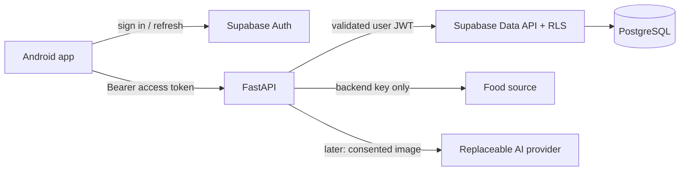

# Architecture proposal

## Current Stage 4 status — 2026-10-30

Stage 4 is the user-authorized **offline food-search and portion-preview foundation**, superseding the earlier Stage 4a/4b backend scope. Historical stage notes below are retained as history, not current instructions. No backend/authentication/persistence has been implemented. Stop before Stage 5.

Stage 1 design; no code, schema or services exist. Confirmed constraints and provisional choices are separated in [Decisions](DECISIONS.md).

## Stack and module boundaries

Use React Native, Expo and TypeScript for Android. Prefer Expo Router for navigation and React state for local UI; add a server-state library only when persistence needs justify it. Python FastAPI routes validate Pydantic DTOs, delegate to small domain services and return stable error shapes. Supabase provides PostgreSQL and Auth. One backend deployment is sufficient; no microservices, task queue or vector database at MVP.

Proposed future structure (create folders only when their task begins):

```text
mobile/
  app/                  # route composition
  src/components/       # reusable primitives
  src/theme/            # design tokens
  src/features/         # dashboard, foods, diary, progress, profile
  src/services/         # auth and API transport
  src/domain/           # preview calculations, date/goal helpers
backend/
  app/main.py
  app/api/              # thin routes and authentication dependency
  app/domain/           # deterministic nutrition, goals, recipes
  app/services/         # diary transactions, imports, recognition
  app/repositories/     # persistence boundary
  app/providers/        # food data and later AI adapters
  tests/
supabase/migrations/    # schema, constraints, RLS, transactional functions
docs/
```

## Data flow and authorization



Mobile signs in with Supabase Auth and stores session material using an Expo-compatible secure storage adapter. FastAPI verifies signature via issuer JWKS with a fixed algorithm allowlist, issuer, audience and expiry; derive identity from the verified subject, never a request `user_id`. Handle signing-key rotation and refresh failure. Forward the user's access JWT to Supabase Data API so `auth.uid()` policies apply. No service-role client in normal user requests. This avoids implementing session identity in privileged direct database connections. See [RLS documentation](https://supabase.com/docs/guides/database/postgres/row-level-security).

The app uses the backend for catalog and private domain operations; it does not gain write access to diary tables through a second unvalidated route. For diary writes, plan an atomic security-invoker database function that reads an accessible immutable food version, validates quantity and ownership, computes the snapshot using reviewed decimal rules, and inserts or updates the entry. Restrict direct table mutation grants so clients cannot bypass this path with fabricated snapshots. FastAPI uses the same domain specification for validation and previews. Verify grants, function search path and RLS together in Stage 5; if an invoker design cannot enforce grants safely, explicitly review a narrow hardened definer function before implementation, never fall back silently to a service-role write.

Public catalog is readable only for published approved records; import/migration roles control writes. Private custom-food versions are readable only by their owner. Avoid trusting caller-supplied catalog matches, owner fields or snapshots.

## Conceptual relational model

These are candidate tables, not executable migrations. UUID IDs unless an external identifier is explicitly separate.

| Entity | Relationships and integrity |
| --- | --- |
| profiles | One per Auth user; timezone, preferences, exclusions; owner-only |
| goal_sets / goal_values | User + effective date unique; nutrient-specific targets; nonnegative finite values; immutable history revisions |
| food_sources | Source URL, external dataset/version, license, attribution, retrieval date, permission evidence and redistribution status |
| foods / food_versions | Stable identity plus immutable preparation, edible basis, state, brand/aliases, reference mass and provenance; optional owner for custom foods |
| nutrient_definitions / food_nutrients | Controlled nutrient code and unit, method/basis; unique version + nutrient; numeric amount or explicit missing status; no absent-to-zero conversion |
| serving_conversions | Food version + label + grams per unit; positive, evidence-backed, never global to every bowl or roti |
| diary_days | Unique user + local date; logging-complete flag, timezone at creation, timestamps |
| diary_entries | Day + owner, meal category, quantity/serving snapshot, food version, name/source and nutrient snapshot, calculation version, UTC audit timestamps |
| recipes / recipe_versions / recipe_ingredients | Owner and immutable versions; ingredient food versions and grams; positive final edible yield or serving count; initially no nested recipes/cycles |
| saved_meals / saved_meal_items | Owner, independent template item quantities and version references; copying creates new diary snapshots |
| favorites | Unique owner + accessible food identity |
| weight_measurements | Owner + local date unique initially; positive kg, editable daily measurement; weekly averages derived |
| achievement_records | Unique owner + rule version + qualifying date/key; derived and revocable on corrections |
| recognition_requests | Later only: owner, provider/model, status, timing, cost and sanitized error category; no raw photo or prompt storage by default |

Use foreign keys and database CHECK constraints, not just UI validation. Private parent/child relationships must enforce the same owner (composite foreign keys or equivalent checked access); a foreign key alone does not enforce tenant ownership. Catalog corrections create versions; historical references stay resolvable. Use tombstones for referenced food versions instead of cascading deletion into diary history. Account deletion intentionally removes that user's private graph.

Index diary days on `(user_id, local_date)`, entries on `(day_id, meal_category)`, weights/goals on owner/date, and all ownership/FK columns used by policies. Unique source/external-ID/version prevents repeated imports. Start catalog search with indexed normalized names/aliases and measured prefix matching; evaluate PostgreSQL text search/trigrams only if needed. No partitioning or precomputed daily cache initially; aggregate snapshots with completeness metadata.

Use ordered reviewed SQL migrations in `supabase/migrations/` as the single schema authority, including RLS and grants. Test fresh installation and upgrade on disposable data; backup and rehearse restoration before destructive migrations. Do not maintain competing ORM and Supabase migration histories. Add SQLAlchemy/Alembic only after a recorded change in persistence strategy.

## Calculation contract

1. Normalize units and edible reference mass during import. Store kcal, grams, and canonical micronutrient units with original source metadata. Do not combine available carbohydrate and carbohydrate by difference without a documented mapping.
2. For each known nutrient: `amount = per_100g × grams / 100`. Serving entry becomes `serving_count × food_version.grams_per_serving`. Missing conversion blocks that unit and asks for grams.
3. Use Python Decimal and PostgreSQL NUMERIC; provisional storage precision `NUMERIC(20,8)`, rounded half-up only at persistence boundaries. Reject nonfinite values and enforce bounded quantities before multiplication. Transfer decimal strings to avoid JSON float loss. Validate mobile preview parity with shared synthetic vectors at Stage 4; final save uses authoritative values returned by backend/database.
4. Sum unrounded values; round only display to whole kcal, 1 decimal g for macros/fiber, and nutrient-specific precision for micronutrients. Never add display-rounded entries to produce totals. Document unavoidable source precision; extra decimal places are not extra accuracy.
5. Preserve reported source energy and method. If only kJ is available, use `kcal = kJ / 4.184`, flagged converted. Do not replace reported energy using 4/4/9, because fiber and source factors differ. If energy is missing, keep it unknown; an explicitly labeled derived-energy option requires a later reviewed policy.
6. Per nutrient, total known values plus coverage (`known_entries`, `total_entries`, status complete/partial/no_entries). All missing means unknown, not zero. A recipe nutrient is partial if any ingredient lacks it.
7. Recipe total is the sum of ingredient amounts. Per-100 g is `total × 100 / final_yield_g`; per serving is `total / serving_count`. If both are supplied, validate consistency or show distinct declared serving assumptions. Cooking loss/retention is not silently invented.
8. A diary snapshot includes nutrient amounts and missingness, reference values, source/version, original quantity/unit conversion and engine version. Entry edits create a replacement snapshot from its original food version unless the user explicitly selects a new food version. Food/recipe edits never recalculate old diary entries automatically.

Daily/date, goal, streak, BMI and weight formulas follow [PRD](PRD.md). BMI input may use cm, but converts explicitly to metres. Goals, dates and totals use one documented contract across clients.

## Local versus server work

Mobile handles date selection, presentation, validated draft quantity previews, BMI and simple chart transforms. Server validates all writes, calculates authoritative nutrition and goal/streak results, handles imports, authorized persistence and future AI. Cached server results are read-only when offline; no silent queued writes or multi-device conflict resolution in MVP. Mutations use a client-generated idempotency UUID scoped to user/operation; reuse with a different payload is a conflict. Add optimistic version checks for concurrent edits to avoid last-write data loss.

## Future AI boundary

Provider adapter concept: `recognize(image_bytes, mime_type, context) -> RecognitionProposal`. A proposal contains candidate names, estimated grams or unknown, alternatives, uncertainty notes, hidden-ingredient questions, provider/model and timing. Confidence is an uncalibrated signal, not an accuracy guarantee. Validate bounded schema with Pydantic; reject invented catalog IDs and ignore model calorie totals. Match candidates in the trusted catalog separately; unmatched foods require user search or later custom-food flow.

Flow: validate upload → explicit processing consent → provider with timeout and spend limit → validated proposal → catalog candidates → editable review → explicit save through the normal diary transaction. No tools, browsing or autonomous diary writes are granted to the model. No automatic paid-provider failover; retries are bounded and charge-aware. Text input can use the same proposal boundary later.

## Main risks

Indian prepared-food coverage and IFCT licensing; variation in oil/yield; database and mobile decimal parity; RLS/grant bypass paths; Expo SDK/Expo Go transition; Android SDK/JDK compatibility; slow free hosting; incomplete micronutrients; image retention at third parties. Research and Decisions identify the gates that must resolve these before their stages proceed.

## Stage 2 implementation — 2026-10-30

User approved Stage 2 in the current request. Implemented in `apps/mobile/` (supersedes the earlier `mobile/` proposal). Single empty diary screen, theme tokens, strict TypeScript, safe areas and a clearly labeled placeholder Add Food alert. No real nutrition data or services.

Verified: typecheck, lint, formatting, one AA contrast test, Expo Doctor 21/21, public Expo config and Android Hermes bundle export passed. `npm start -- --localhost` started Metro at port 8081; its status endpoint returned `packager-status:running`. This verifies development-server startup, not on-device rendering. No Android execution: adb/emulator unavailable on PATH, Android SDK variables unset and standard local SDK adb absent. Device layout, TalkBack and font scaling still require manual verification.

Installed: Expo 57.0.31, React Native 0.86.3, React 19.2.3, safe-area-context 5.7.0, TypeScript 6.0.3, ESLint 9.39.5/config-expo 57.0.2, Prettier 3.9.10, Expo Doctor 1.21.5. Node 22.23.2/npm 10.9.8. Lockfile records transitive versions. SDK 57 follows current Expo Go transition guidance: https://docs.expo.dev/get-started/create-a-project/ . No navigation library needed yet.

Known issues: npm audit retains 8 transitive advisories (5 low, 3 high) involving Expo tooling's deepmerge/zod chain after compatible `npm audit fix`; forced remediation proposes incompatible Expo 51 downgrade and was not applied. Resolve/reassess before release. Expo-selected ESLint 9 emits an upstream support warning; retain compatibility pending supported SDK upgrade. The Node contrast test emits a module-type detection warning but passes. No claim of production security readiness.

Next: review Stage 2 and verify the screen on Android before Stage 3. Stage 3 has not begun.

## Current mobile runtime: SDK 58

The existing single-screen `apps/mobile` structure is unchanged. Expo 58.0.21 aligns React Native 0.88.1, React 19.3.0, expo-status-bar 58.0.4 and safe-area-context 5.10.1; TypeScript remains 6.0.3. Expo added the `expo-status-bar` config plugin. No generated native projects, navigation, backend or new feature dependencies were introduced. Strict TypeScript remains enabled without the legacy React Native type opt-out.

## Stage 3 dashboard — 2026-10-30

Stage 3 uses Expo Router 58.0.28 with file routes under apps/mobile/app, replacing the scaffold App.tsx/index.ts. React Native Screens 4.30.1, Expo Linking 58.0.15 and Constants 58.0.14 were aligned by Expo. Route files compose feature screens; reusable cards/actions/progress live in src/components/dashboard.tsx. Mock fixtures live in src/data/dashboardPreview.ts; pure sums and progress rules live in src/domain/dashboard.ts. This is preview arithmetic only, not the Stage 4 nutrition engine. Router owns navigation/safe-area context; screens reserve top/side insets and tabs reserve the bottom. No backend, storage, auth or AI added.

## Implemented Stage 4 boundaries

`src/data/foods.ts` contains 12 authored synthetic fixtures. Each Food has a stable ID, aliases, category, preparation, referenceGrams=100, nullable calories/protein/carbs/fat/fiber, illustrative status and explicit source text. Values are examples, not sourced dietary advice; null remains unknown. No micronutrients, universal serving conversions or cooking conversions are inferred.

`src/domain/food.ts` owns case-insensitive trimmed substring name/alias search (catalog order, deduplicated IDs), strict positive decimal gram parsing, finite nonnegative reference validation, scaling and display formatting. Calculations use source energy directly, keep unrounded numbers and reject nonfinite outputs/underflow. Whole kcal and one decimal gram are display rules only. Binary floating point is sufficient for this temporary sample preview; authoritative Decimal/NUMERIC persistence remains unimplemented.

Root Stack wraps existing `(tabs)` without changing public tab paths. `food-search` owns a reducer-based local draft and search/detail views. Detail Back retains query, food, grams, meal and confirmation; selecting another food resets portion to 100 g. Exiting removes the temporary draft. Route meal parameters are allowlisted to four meals; generic Add Food has no meal. Confirm displays a preview only, with no dashboard mutation or storage. Local search is synchronous, so there is no simulated loading state. No-result, invalid portion and unavailable-food fallbacks are explicit. Inputs use keyboard avoidance and scrollable content; device behavior still requires testing.

Navigation references: [Expo layouts](https://docs.expo.dev/router/basics/navigation-layouts/) and [React Native BackHandler](https://reactnative.dev/docs/backhandler).
